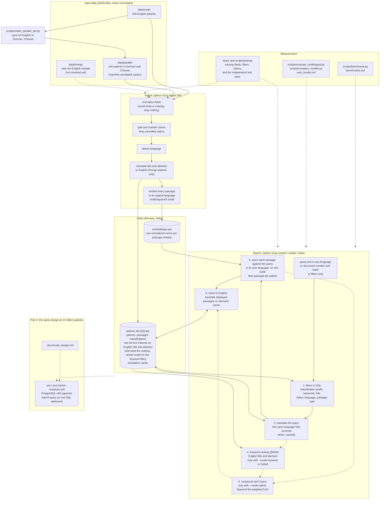

# Architecture

One picture of the whole project. Solid arrows are data moving. Dotted arrows are "measures" or "is a model of". Inside the search box, dotted arrows are steps taken only with `--mode keyword` or `--mode hybrid`: the default search is semantic.

## Where each piece lives

| Piece | File |
| --- | --- |
| Schema | `src/db.py` |
| Field normalization, claim parsing, missing field handling | `src/ingest.py` |
| Embedding model, windows, vector files | `src/embed.py` |
| Language detection, translation, cache | `src/translate.py` |
| Filters, query translation, semantic ranking (default), optional keyword ranking and fusion | `src/search.py` |
| Command line and display | `cli.py` |
| Timing | `scripts/benchmark.py` |
| Synthetic German and Chinese set | `scripts/make_parallel_set.py` |
| English against foreign comparison | `scripts/evaluate_multilingual.py`, `scripts/compare_models.py` |
| Scale design and its proof of concept | `docs/scale_design.md`, `poc/` |
