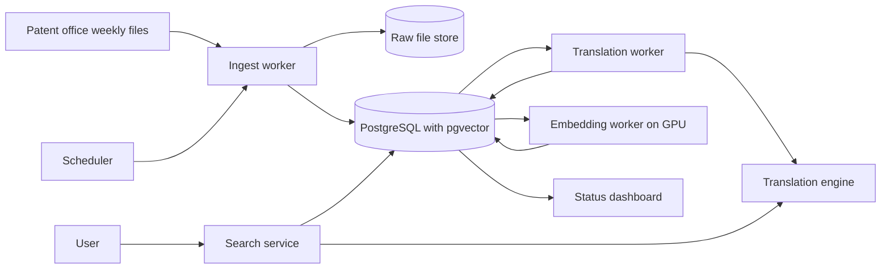

# Part 2: the same search engine for 10 million patents

How to read this document:

- **Measured** means the number comes from Part 1 (`NOTES.md`, `benchmarks.md`, or a query on the Part 1 index).
- **Assumption** means nobody has measured it yet. Assumptions are numbered A1 to A11 in section 7.1.
- Prices are in United States (US) dollars and were checked on 16 November 2026. Section 7.8 says which ones could be verified.
- Units: B is bytes, kB, MB and GB are 10^3, 10^6 and 10^9 bytes. MiB and GiB are 2^20 and 2^30 bytes (cloud providers size memory in GiB). ms, s and h are milliseconds, seconds and hours.

## 1. Goal and scope

Part 1 searches 640 patents on a laptop. This document describes the same search for 10 million patents: passages embedded in their original language with one multilingual model, the short query translated into each language that has patents, keyword search over the English title and abstract, filters applied before any vector is scored, and the keyword ranking fused in as an option. Part 1 measured that semantic ranking alone is the better default, and that a fused keyword list must count far less than the semantic one (`README.md`, section 3).
Phase 1 embeds the abstract and the claims: 174 million vectors, 135 GB at half precision.
Phase 2 adds the description paragraphs: 512 million vectors in total, 397 GB.
The design is one PostgreSQL database with the pgvector extension and a few small workers around it. It was picked because it is simple, and section 8 says where it will hurt. User accounts, drawings and legal status data are out of scope.

## 2. Components

| Component | What it does | What it runs on |
| --- | --- | --- |
| Raw file store | Keeps every weekly file exactly as downloaded. It is the source of truth: everything else can be rebuilt from it | Object storage (Amazon Simple Storage Service, S3), one folder per week |
| Scheduler | Starts the weekly pipeline and the retry job | cron (the standard Linux job scheduler) on the worker machine |
| Ingest worker | Downloads, parses, validates, detects the language, splits into passages, loads the text | Worker machine: 4 virtual central processing units (CPUs), 16 GiB memory, always on |
| Translation worker | Translates the title and abstract of non-English patents into English | Worker machine. Calls a hosted translation application programming interface (API), or a local model on a machine with a graphics processing unit (GPU) |
| Embedding worker | Turns passages into vectors with `intfloat/multilingual-e5-small` (384 numbers per vector) | One GPU machine, started for the job and stopped afterwards |
| Database | Holds metadata, passage text, the full text index, the vectors, the status table and the translation cache | One managed PostgreSQL with pgvector 0.8 or newer. 256 GiB memory in phase 1 |
| Search service | Translates the query into each language that has patents, encodes each version, runs one Structured Query Language (SQL) statement per language, merges, translates what is shown | 2 small machines (2 virtual CPUs, 8 GiB each) behind a load balancer |
| Status dashboard | Shows counts per stage, week and language. Sends alerts | Grafana (an open source dashboard tool) on the worker machine, reading the database |

There is no separate queue and no separate vector database. The status table is the queue (section 4.1). Keeping text, keywords and vectors in one database means the hybrid query is one SQL statement, there is one thing to back up, and the three can never disagree about which patents exist.



## 3. Data model

This is the Part 1 schema (`src/db.py`) moved to PostgreSQL, plus a vector column, a status table and version columns.

```sql
CREATE EXTENSION vector;
CREATE EXTENSION pg_trgm;                     -- for the "title contains" filter

CREATE TABLE patents (
    id                bigint GENERATED ALWAYS AS IDENTITY PRIMARY KEY,
    doc_number        text UNIQUE NOT NULL,   -- the key every pipeline stage uses
    family_id         text,                   -- same invention filed in several offices, when the source gives it
    title text, title_en text,                -- NULL means missing; *_en is the English version
    abstract text, abstract_en text,
    language          text,                   -- detected; NULL means could not tell
    filing_week       date,
    source_file       text NOT NULL,          -- path of the raw weekly file
    missing_fields    text[] NOT NULL DEFAULT '{}',
    translation_model text,                   -- engine and version that wrote the *_en fields
    search_en tsvector GENERATED ALWAYS AS (  -- keyword search, title weighted above abstract
        setweight(to_tsvector('english', coalesce(title_en, '')), 'A') ||
        setweight(to_tsvector('english', coalesce(abstract_en, '')), 'B')) STORED
);
CREATE INDEX ON patents USING gin (search_en);
CREATE INDEX ON patents USING gin (title_en gin_trgm_ops);
CREATE INDEX ON patents (filing_week);
CREATE INDEX ON patents (language);

CREATE TABLE classifications (
    patent_id bigint NOT NULL REFERENCES patents (id),
    code      text NOT NULL,                  -- upper case, letters and digits only
    PRIMARY KEY (patent_id, code)
);
CREATE INDEX ON classifications (code text_pattern_ops);   -- prefix filter: code LIKE 'B60B%'

CREATE TABLE passages (
    patent_id       bigint NOT NULL,
    kind            text NOT NULL,            -- abstract | claim | description
    ord             int NOT NULL,             -- claim number, or paragraph position
    window_no       int NOT NULL DEFAULT 0,   -- a long passage is cut into windows, one row each
    number_inferred boolean NOT NULL DEFAULT false,
    parent_claim    int,
    text            text NOT NULL,
    embedding       halfvec(384),             -- NULL: not embedded yet, or too short to embed
    embedding_model text,                     -- model name and revision that wrote the vector
    PRIMARY KEY (patent_id, kind, ord, window_no)
) PARTITION BY LIST (kind);
CREATE TABLE passages_abstract    PARTITION OF passages FOR VALUES IN ('abstract');
CREATE TABLE passages_claim       PARTITION OF passages FOR VALUES IN ('claim');
CREATE TABLE passages_description PARTITION OF passages FOR VALUES IN ('description');
-- Built after the bulk load, one partition at a time (section 4.2).
-- Inner product, as in the proof of concept: the vectors have length 1, so it equals cosine similarity.
CREATE INDEX ON passages_abstract USING hnsw (embedding halfvec_ip_ops);
CREATE INDEX ON passages_claim    USING hnsw (embedding halfvec_ip_ops);

CREATE TABLE source_files (                   -- one row per weekly file
    path text PRIMARY KEY, week date NOT NULL, sha256 text NOT NULL,
    records int, status text NOT NULL, downloaded_at timestamptz NOT NULL DEFAULT now()
);
CREATE TABLE document_status (                -- one row per document: the queue and the audit trail
    doc_number  text PRIMARY KEY,
    source_file text NOT NULL REFERENCES source_files (path),
    week        date NOT NULL,
    stage       text NOT NULL,                -- pending | parsed | translated | embedded | failed
    failed_at   text,                         -- parse | translate | embed
    reason      text,
    attempts    int NOT NULL DEFAULT 0,
    updated_at  timestamptz NOT NULL DEFAULT now()
);
CREATE INDEX ON document_status (stage, week);

CREATE TABLE translations (                   -- cache, same idea as Part 1
    key text PRIMARY KEY,                     -- hash of model name and source text
    model text NOT NULL, text_en text NOT NULL, created_at timestamptz NOT NULL DEFAULT now()
);
```

HNSW (hierarchical navigable small world) is the graph index pgvector offers for approximate nearest neighbour search. GIN (Generalized Inverted Index) is the PostgreSQL index for full text search.

**Half precision vectors (`halfvec`).** Each of the 384 numbers is stored in 16 bits instead of 32. A vector takes 776 B instead of 1,544 B, in the table and again in the index. What it buys: the phase 1 index is about 200 GB instead of about 334 GB, so it fits in a 256 GiB machine instead of needing the next size up. What it costs: a small rounding error in every score. The effect on ranking is not measured. The proof of concept in `poc/` ran on pgvector 0.6.2, which has neither `halfvec` (added in 0.7.0) nor iterative index scans (added in 0.8.0, used in section 4.3). Both are untested in this project. Test them in steps 1 and 4 of section 9 before trusting them.

**Differences from the proof of concept.** `poc/` keeps 32-bit vectors in a `passage_vectors` table and its statement uses keywords only as a filter. This design keeps one row per window in `passages`, at half precision, and its statement also ranks by keywords and fuses the two rankings. The fused statement in section 4.3 has not been run.

**Partitioning.** The `passages` table is split by `kind` from the first day.

| Partition by | What it buys | What it costs |
| --- | --- | --- |
| Passage kind (chosen) | Phase 2 only adds vectors and an index to the third partition and never touches the first two. A passage type filter skips whole partitions. Each index can be rebuilt alone | A default query looks in two indexes instead of one |
| Classification section (A to H and Y), option | Nine smaller indexes that each fit in memory while being built. A filter on the section skips the other eight | A query without that filter looks in all nine. Sections differ a lot in size. A patent with codes in two sections lives in one partition, so the filter still needs the `classifications` join to be correct |
| Language, option | One language can be re-embedded or fixed alone. A language filter skips partitions | Same as above. English would still be one very large partition |

Start with kind. Language is the second level to add, and the first one worth adding: section 4.4 searches each language with its own query vector, so one index per language is the natural shape. With only English loaded it changes nothing, so it can wait until the first foreign patents arrive.

## 4. Pipelines

Three words used below. *Idempotent*: running a stage twice gives the same result as running it once. *Upsert*: insert the row, or update it if the key already exists. *Dead letter list*: the place where records that keep failing are parked for a person to look at.

### 4.1 Weekly release pipeline

Every stage is keyed by the document number and can be run again safely.

| # | Stage | What it does | Why it is safe to run twice | Status afterwards |
| --- | --- | --- | --- | --- |
| 1 | Download | Copy the weekly file to `raw/<week>/` in the raw file store. Record path, checksum and record count in `source_files` | Same path, same checksum: skipped | file `downloaded` |
| 2 | Parse | Read each record with Part 1's `normalize` and `parse_claims`, unchanged | Pure functions of the input | document `pending` |
| 3 | Validate | Apply the Part 1 missing field policy: never drop a patent, list what is missing in `missing_fields`. Only a record that cannot be read at all fails | Same | |
| 4 | Detect language | Part 1's `detect_language` on the abstract, else first claim, else description, else title | Seeded, so repeatable | |
| 5 | Split into passages | Abstract, each claim, each description paragraph. Long ones cut into windows of 1,600 characters (400 for Chinese, Japanese, Korean). Write `patents`, `classifications` and `passages` (text only) in one transaction per patent | Upsert on `doc_number`. Old passages of that patent are deleted first | `parsed` |
| 6 | Translate short fields | Non-English only: title and abstract to English through the `translations` cache. English: copy | Cache key is a hash of model and text, so a second run costs nothing | `translated` |
| 7 | Embed | Passages of at least 40 characters (15 for Chinese, Japanese, Korean), original language, prefix `passage: `. Batches of 500 patents | Same text and model give the same vector | |
| 8 | Upsert vectors | Write `embedding` and `embedding_model` for the batch, one transaction per batch | Overwrites the same rows | `embedded` |

The split (stage 5) runs before translation because it needs only the language, and it leaves every document complete and displayable from `parsed` onwards.

How a worker takes work, with no queue software. Two workers never get the same rows, and a worker that crashes releases its rows when its connection closes:

```sql
SELECT doc_number FROM document_status
WHERE stage = 'translated'            -- the embedding worker; other workers use their own input stage
ORDER BY doc_number LIMIT 500
FOR UPDATE SKIP LOCKED;
```

A corrected patent that arrives in a later weekly file with the same document number replaces the old one and goes through every stage again.

### 4.2 One-time backfill of 10 million patents

Same code as the weekly pipeline, run wide, with indexes built last.

| Step | What | How long (see section 7.3 for the arithmetic) |
| --- | --- | --- |
| 1 | Copy all historical files to the raw file store | Depends on the source. Not estimated |
| 2 | Parse and load text with 8 processes. No vector index exists yet, so inserts are fast | About 28 process-hours, so about 3.5 h on 8 processes |
| 3 | Translate title and abstract for the foreign share, in batches, respecting the provider's rate limit | Hosted: limited by the provider's quota, not estimated. Local: see section 7.4 |
| 4 | Embed abstract and claims on 4 GPU machines in parallel | 48.3 GPU-hours, so about 12 h |
| 5 | Run `VACUUM` on each partition. Each vector update left an old text-only row version behind (about 60 GB in phase 1) | Not measured |
| 6 | Build the HNSW indexes, one partition at a time, with a large `maintenance_work_mem` and `max_parallel_maintenance_workers` | Not measured at this size. The proof of concept built its indexes for 32,772 vectors in 6.2 s. Scaled in a straight line that is 9.1 h for 174 million. HNSW builds slow down as the graph grows, so expect more. Assumption: 1 to 3 days |
| 7 | Compare counts with the source (section 6), run the 20 benchmark queries from Part 1, then open the search service | 1 day |

Build the index after the load, not before: inserting into an existing HNSW index is much slower than building it once.

### 4.3 Query path

1. The search service receives query text in any language, or a document number, plus filters.
2. It translates the query into each language that has patents passing the filters (section 4.4), and encodes every version with the prefix `query: ` (measured: about 14 ms per version on the laptop). Translations and query vectors are cached by text. For a document number it takes the text of that patent's claim or abstract and treats it the same way, as Part 1 does.
3. It counts the patents that pass the filters, stopping at a cap: `SELECT count(*) FROM (SELECT 1 FROM patents WHERE ... LIMIT 60000) x`.
4. It picks a route (table below) and runs one SQL statement.
5. It fetches titles and best passages, and translates non-English passages for display through the cache.

| Part 1 filter | SQL condition | Index used |
| --- | --- | --- |
| Classification prefix | `EXISTS (... classifications WHERE code LIKE 'B60B%')` | B-tree on `code` |
| Keywords (all must appear) | `search_en @@ to_tsquery('english', 'tire & pressure')` | GIN on `search_en` |
| Title contains | `title_en ILIKE '%wheel bearing%'` | trigram GIN on `title_en` |
| Filing week range | `filing_week BETWEEN ... AND ...` | B-tree |
| Language, passage type | `language = 'de'`, `kind IN (...)` | B-tree, partition choice |

**Which route, and why.** The Part 1 measurements decide this.

| Situation | Measured on the laptop | What it means at 174 million vectors | Route |
| --- | --- | --- | --- |
| No filter | Exact scoring: 36.3 ms per 983,160 vectors | 174,000,000 / 983,160 × 36.3 ms = 6.4 s per query at the laptop rate. Too slow | Approximate index |
| Filter keeps 1% | Filter first 2.4 ms, filter after 32.5 ms: 13.5 times faster, scoring step only | 1.74 million vectors survive: about 0.06 s at the laptop rate | Exact after the filter, once fewer than about 1 million vectors survive (a filter that keeps under about 0.6%). At 1% the count is above that, so the rule below sends this one to the approximate index until the threshold has been tuned |
| Filter keeps more than about 15% | Filter first was slower than scoring everything, because of the row copy | Tens of millions of vectors survive. Exact is too slow | Approximate index, filter checked during the index scan |

Rule to start with: **exact search when the filter leaves fewer than about 1 million vectors, the approximate index otherwise.** One million vectors is about 57,000 patents in phase 1 (1,000,000 / 17.4) and about 19,500 in phase 2 (1,000,000 / 51.2). The laptop scored that many in about 37 ms (about 75 ms in the run before, so treat the rate as rough). PostgreSQL reads rows from disk pages and will be slower per vector than NumPy. That rate is not measured yet, so the threshold is a starting value to tune (section 9, step 4).

The proof of concept shows why the rule is needed (`poc/README.md`). With two filters that 12 patents pass, exact search returned the 10 correct patents in about 1 ms. Forced onto the index, the same statement returned 6 of the 10 with default settings and 8 of the 10 with the largest `hnsw.ef_search`, because the filters run after a capped index scan. There the PostgreSQL planner chose the exact route by itself. Do not rely on that at scale, where its row estimates for combined filters can be far off. The search service decides.

The statement, shown for the approximate route. With no filters, leave out `allowed` and the two `IN (SELECT id FROM allowed)` lines. `<#>` is negative inner product: smaller is nearer. The proof of concept runs the filter and vector part of this statement on a real PostgreSQL. Treat the SQL there as the tested version and this as the sketch.

```sql
BEGIN;
SET LOCAL hnsw.ef_search = 500;                 -- the index hands over at most this many rows per pass
SET LOCAL hnsw.iterative_scan = relaxed_order;  -- keep scanning until enough rows pass the filter
WITH allowed AS MATERIALIZED (                  -- 1. filters first, on indexed columns
    SELECT p.id FROM patents p
    WHERE p.filing_week >= '2024-01-01'
      AND EXISTS (SELECT 1 FROM classifications c WHERE c.patent_id = p.id AND c.code LIKE 'B60B%')
), nearest AS (                                 -- 2. nearest passages among the survivors
    SELECT s.patent_id, s.embedding <#> $1::halfvec(384) AS distance
    FROM passages s
    WHERE s.kind IN ('abstract', 'claim') AND s.patent_id IN (SELECT id FROM allowed)
    ORDER BY s.embedding <#> $1::halfvec(384)
    LIMIT 500
), semantic AS (                                -- 3. best passage per patent, ranked
    SELECT patent_id, row_number() OVER (ORDER BY min(distance)) AS rank
    FROM nearest GROUP BY patent_id
), keyword AS (                                 -- 4. keyword ranking, English title and abstract
    SELECT p.id AS patent_id, row_number() OVER (ORDER BY ts_rank_cd(p.search_en, q) DESC) AS rank
    FROM patents p, to_tsquery('english', $2) q -- $2: query words joined with |
    WHERE p.search_en @@ q AND p.id IN (SELECT id FROM allowed)
    ORDER BY ts_rank_cd(p.search_en, q) DESC
    LIMIT 200
)
SELECT patent_id,                               -- 5. reciprocal rank fusion, constant 60, keyword list weighted 0.02 as in Part 1
       coalesce(1.0 / (60 + s.rank), 0) + coalesce(0.02 / (60 + k.rank), 0) AS score  -- semantic only (the default): drop the keyword term
FROM semantic s FULL OUTER JOIN keyword k USING (patent_id)
ORDER BY score DESC LIMIT 10;
COMMIT;
```

For the exact route, replace the two `SET LOCAL` lines with `SET LOCAL enable_indexscan = off;`. An HNSW index can only be read through an index scan, so PostgreSQL then scores every surviving row. This is the way the pgvector documentation gives and the way the proof of concept did it. One known weak point: 500 passages can belong to few patents. If fewer than 10 patents come back, run again with a larger `LIMIT`.

### 4.4 Cross-language search: one query per language

Part 1 measured that one query vector cannot serve several languages (`eval_results.md`). With one English query vector and a mixed corpus, the right German or Chinese patent was ranked below hundreds of English ones, because the model scores two unrelated passages in the same language higher than a passage and its own translation. Larger models reduced this and did not remove it (`scripts/compare_models.py`).

So the search service does what Part 1 does:

1. Detect the language of the query. Translate it to English if it is not English.
2. From English, translate it into each language that still has patents after the filters. A language filter of `en` means no translation at all.
3. Encode every version.
4. Run the vector part of the statement once per language, each restricted to that language's patents and with that language's query vector. The language is a column of `patents`, not of `passages`, so the restriction is the same join the filters use (`patent_id IN (SELECT id FROM patents WHERE language = ...)`).
5. Put each language's scores on one scale before merging. For each language, score a fixed random sample of a few thousand of its passages against that language's query vector, and express every score as (score - sample mean) / sample spread. Then merge. The passages are never translated for search.

What this costs:

| Item | Value |
| --- | --- |
| Translations per query | One per foreign language present after filtering, cached by query text |
| Translation time, laptop | See "What query translation costs per query" in `eval_results.md` (measured on claim-length queries, the worst case) |
| Vector searches per query | One per language instead of one. They can run in parallel |
| Calibration per query | One small matrix product per language (a few thousand sampled vectors, kept in memory by the search service) |
| Extra storage | None |

Why step 5 exists: each language has its own score level. In Part 1, unrelated Chinese passages scored about 0.85 against a Chinese query where unrelated English passages scored about 0.79 against the English query. Merged raw, Chinese patents won on that offset alone and pushed English ones out (`eval_results.md`, sections 3 and 4). Part 1 shipped that mistake first and found it only by using the tool, so keep both of those tests in the daily check.

What it does not fix: it adds a dependency on translating the query well. A query is short and can be shown to the user in translated form for checking, which a translated corpus cannot. And the calibration assumes the sampled passages of every language are mostly unrelated to the query, which fails if one language's patents are concentrated in one technical field. The sample should then be drawn per classification section.

## 5. Errors

One bad record never fails a weekly batch. Each document moves on its own, and the batch finishes with whatever succeeded.

| Stage value | Meaning |
| --- | --- |
| `pending` | Seen in a weekly file, nothing stored yet |
| `parsed` | Patent, classifications and passage text are in the database |
| `translated` | English title and abstract are filled (or the patent is English) |
| `embedded` | Every passage long enough has a vector. Done |
| `failed` | A stage raised an error. `failed_at` says which stage, `reason` holds the error text, `attempts` counts tries |

| What goes wrong | What happens |
| --- | --- |
| Download fails, or the checksum does not match | The file is retried every hour. Alert after 24 h. Earlier weeks are not affected |
| The whole file is not valid JavaScript Object Notation (JSON) | `source_files.status = 'failed'`, alert. No document rows are created |
| A record is not a dictionary | It gets the key `BAD-RECORD-<file>-<position>` and goes to `failed` with the reason. The rest of the file continues |
| A record has no document number | Not an error. It gets `NO-NUMBER-<file>-<position>`, as in Part 1 |
| A field is missing or empty | Not an error. Stored with `missing_fields`, searched through what it has |
| The language cannot be detected | Not an error. `language` is NULL, nothing is translated, the passages are still embedded |
| Translation times out, is rate limited, or has no model for the language | `failed` at `translate`, retried |
| The GPU runs out of memory on a batch | The worker halves the batch and tries again. If one patent still fails: `failed` at `embed` |
| The GPU machine dies in the middle | Nothing to clean up. Unfinished documents are still `translated` and the next run takes them |
| A passage is longer than the model reads | Not an error. Counted (section 8, last row) |

**Bounded retries.** A retry job runs every 10 minutes. It takes `failed` rows with `attempts < 3`, waits 10 minutes before the second try and 1 h before the third, and puts the row back to the stage before the one that failed (`parse` to `pending`, `translate` to `parsed`, `embed` to `translated`).

**Dead letter list.** After 3 attempts a row stays `failed`. The dead letter list is simply `SELECT * FROM document_status WHERE stage = 'failed' AND attempts >= 3`, shown on the dashboard grouped by reason.

**Replay.** After fixing the cause, reset the rows. Every stage is idempotent, so this is always safe:

```sql
UPDATE document_status SET stage = 'translated', attempts = 0, reason = NULL, failed_at = NULL
WHERE stage = 'failed' AND failed_at = 'embed' AND week = '2026-11-12';
```

Known weakness: a patent that fails translation three times is not embedded and so is not searchable until someone replays it. If that happens often, the simplest fix is to let the embedding worker also take those rows, since embedding does not need the translation.

## 6. Tracking contents and status

**Versions on every row.** `passages.embedding_model` holds the model name and revision that wrote each vector. `patents.translation_model` and `translations.model` do the same for translations. Vectors from two models cannot be compared, so the search service must only ever query one version, and these columns are how you find what is left to redo.

**Counts.** One view feeds most of the dashboard:

```sql
CREATE VIEW pipeline_counts AS
SELECT d.week, p.language, d.stage, count(*) AS patents
FROM document_status d LEFT JOIN patents p USING (doc_number)
GROUP BY d.week, p.language, d.stage;
```

| Dashboard panel | What it shows |
| --- | --- |
| This week's file | Downloaded or not. Records in the file against status rows created |
| Stage counts per week | Patents in `pending`, `parsed`, `translated`, `embedded`, `failed` |
| Per language | Patents, share with an English title and abstract, share embedded, share with language unknown |
| Failures | Dead letter list grouped by `failed_at` and reason |
| Contents | Total patents, passages and vectors per kind. Vectors per `embedding_model`. Patents per missing field. Windows longer than 512 tokens |
| Database | Disk used, size of each index, memory, connections |
| Search | Queries per minute, median and 95th percentile time, share on each route, share with no results |
| Translation | Characters sent this month, cost so far, cache hit rate |

| Alert | Fires when |
| --- | --- |
| Missing weekly file | No new file 24 h after the usual arrival time |
| Lost records | `source_files.records` differs from the number of status rows for that file |
| Too many failures | More than 1% of a week's documents are `failed` |
| Stuck documents | Any document not `embedded` or `failed` 48 h after its file arrived |
| Mixed model versions | More than one `embedding_model` in a partition outside a planned migration |
| Disk | Database disk above 80% |
| Slow search | 95th percentile above 2 s for 15 minutes (assumption: 2 s is acceptable to users) |
| Translation budget | Month-to-date translation cost above the monthly budget |
| Search still works | A daily run of 20 fixed queries no longer returns its known patents |

## 7. Cost breakdown

### 7.1 Inputs

Measured on the Part 1 sample (640 US patent applications, all in class B60, vehicles):

| Input | Value | Where from |
| --- | --- | --- |
| Vectors per patent, abstract and claims | 17.4 (11,120 / 640) | Part 1 index |
| Vectors per patent, full text | 51.2 (32,772 / 640) | `NOTES.md` |
| Characters per patent, full text | 24,000 (15.36 million / 640) | `NOTES.md` |
| Characters per patent, title plus abstract | 736 (41.8 + 694.6) | Part 1 index |
| Raw file size per patent | 25.2 kB (16.1 MB on disk / 640; the JSON itself is 15.9 MB, 24.9 kB) | `data/small` on disk |
| Part 1 database per patent (text, metadata, full text index) | 32.8 kB (21.0 MB / 640) | `index/patents.db` |
| Bytes per vector | 1,536 B as 32-bit floats. 768 B at half precision, 776 B stored | 384 numbers |
| Embedding speed, laptop GPU | 138 to 330 vectors/s (the slowest of the recorded runs was on battery in Low Power Mode) | `NOTES.md` |
| Parse and load speed without embedding | About 100 patents/s per process (640 patents in 5.6 to 6.8 s: whole ingest minus embedding time, over five runs. A sixth run took 8 min 45 s on a laptop that was partly idle, 2 patents/s by the same subtraction, and is not used) | `NOTES.md` |
| Exact scoring speed | 36.3 ms per 983,160 vectors (73.7 ms in the run before, same laptop) | `benchmarks.md` |

Assumptions:

| # | Assumption | Value |
| --- | --- | --- |
| A1 | The 10 million patents have the same shape as the 640 sampled ones | Same vectors and characters per patent |
| A2 | Share of non-English patents | 30%, so 3,000,000 patents |
| A3 | A foreign title and abstract are as long as an English one | 736 characters. Too high for Chinese, Japanese and Korean |
| A4 | One rented NVIDIA A10G GPU embeds faster than the laptop | 1,000 vectors/s (3.0 to 7.2 times the laptop) |
| A5 | HNSW index size per vector at half precision, default settings | 1.5 × 768 B = 1,152 B. Support: the proof of concept measured 59 MiB for 32,772 32-bit vectors, which is 1,888 B each. Half precision removes 768 B of that, leaving 1,120 B. Half precision itself was not run |
| A6 | Memory needed so the index stays in memory | Index size × 1.25 |
| A7 | PostgreSQL needs as much space for text as Part 1's SQLite, plus a row header | 32.8 kB per patent plus 24 B per passage row |
| A8 | New patents per week | 10,000 |
| A9 | Search volume and display translation | 1,000 searches per day, 30 days, 3 foreign results each, 500 characters each, no cache hits |
| A10 | Hours and weeks per month | 730 h, 4.33 weeks |
| A11 | The database runs for one month before launch (backfill, index build, checks) | 730 h |

### 7.2 Vectors, bytes, memory, disk

| Line | Arithmetic | Phase 1 (abstract, claims) | Phase 2 (full text, total) |
| --- | --- | --- | --- |
| Vectors | 10,000,000 × 17.4 and × 51.2 | 174,000,000 | 512,000,000 |
| As 32-bit floats | × 1,536 B | 267.3 GB | 786.4 GB |
| At half precision, in the table | × 776 B | 135.0 GB | 397.3 GB |
| HNSW index (A5) | × 1,152 B | 200.4 GB | 589.8 GB |
| Memory needed (A6) | index × 1.25 | 250.6 GB | 737.3 GB |
| Instance memory chosen | 256 GiB = 274.9 GB. 768 GiB = 824.6 GB | 256 GiB | 768 GiB (512 GiB = 549.8 GB is too small) |
| Text and metadata (A7) | 10,000,000 × 32.8 kB = 328.0 GB, plus 512,000,000 × 24 B = 12.3 GB | 340.3 GB | 340.3 GB |
| Disk used | text + vectors + index | 675.7 GB | 1,327.4 GB |
| Disk provisioned | Room to rebuild an index beside the old one | 1,000 GB | 2,000 GB |

All passage text, descriptions included, is loaded in phase 1 so that any patent can be displayed. Phase 2 adds vectors and one index, not text.

### 7.3 One-time: backfill compute

| Line | Arithmetic | Phase 1 | Phase 2, extra |
| --- | --- | --- | --- |
| Vectors to embed | | 174,000,000 | 338,000,000 |
| GPU time (A4) | vectors / 1,000 per s / 3,600 | 48.3 h | 93.9 h |
| GPU cost | hours × $1.006 | $48.62 | $94.45 |
| Worst case: no faster than the slowest laptop run | vectors / 138 per s / 3,600, × $1.006 | 350.2 h, $352.34 | 680.4 h, $684.44 |
| Parse and load | 10,000,000 / 100 per s = 100,000 s = 27.8 process-hours. Budget 24 h of one 8 virtual CPU machine at $0.29 per hour | $6.96 | $0 (text already loaded) |
| Database before launch (A11) | 730 h × $4.00 + 1,000 GB × $0.115 | $3,035.00 | $0 (already running) |

Embedding the abstract and claims of all 10 million patents costs less than one day of the database ($4.00 × 24 h = $96). Compute is not where the money goes.

### 7.4 One-time: translation

| Option | Characters | Price per million characters | Cost |
| --- | --- | --- | --- |
| Title and abstract, foreign share, hosted (base case, Azure Translator) | 3,000,000 × 736 = 2,208,000,000 | $10 | $22,080 |
| Same, Amazon Translate | 2,208,000,000 | $15 | $33,120 |
| Same, Google Cloud Translation | 2,208,000,000 | $20 | $44,160 |
| **All full text up front, hosted (rejected)** | 3,000,000 × 24,000 = 72,000,000,000 | $10 | $720,000 |
| Title and abstract, local open-source model on a rented GPU | 2,208,000,000 | none | 2,208,000,000 / R / 3,600 × $1.006, where R is characters per second |

Translating everything up front would cost 32.6 times more than translating the two short fields ($720,000 against $22,080), and it would buy nothing for search, because passages are embedded in their original language. That is why only the title and abstract are translated at ingest and everything else only when a result is shown.

The local path uses the same Helsinki-NLP `opus-mt` models as Part 1, behind the same `translate_texts` function.

Measured local translation throughput (Part 1, Apple M2 Pro laptop GPU, Helsinki-NLP opus-mt):

| What was measured | Characters per second |
| --- | --- |
| Title and abstract into English at ingest, one patent at a time, beam width 4 (100,829 characters in 224.9 s) | 448 |
| Bulk translation out of English in batches of 64, greedy decoding (2,778,802 characters in 395 s and in 458 s) | 7,035 (German) and 6,067 (Chinese) |

Cost of the local path at those rates, assuming a rented A10G is no faster than the laptop: at 448 characters per second, 2,208,000,000 / 448 / 3,600 = 1,369 GPU-hours × $1.006 = $1,377. At 6,067 characters per second, 101 GPU-hours = $102. Either is far below the $22,080 hosted price. The first figure is the unbatched worst case; batching across patents is the obvious first improvement.

The break-even point: the local path is cheaper than $22,080 whenever R is above 28 characters per second on one GPU ($22,080 / $1.006 = 21,948 GPU-hours = 79.0 million seconds, and 2,208,000,000 / 79.0 million = 28). The open questions for the local path are translation quality and engineering time, not compute cost.

### 7.5 Monthly

| Line | Arithmetic | Phase 1 | Phase 2 |
| --- | --- | --- | --- |
| Database instance, managed, one zone | $4.00 × 730 h. $12.00 × 730 h | $2,920.00 | $8,760.00 |
| Database storage | 1,000 GB and 2,000 GB × $0.115 | $115.00 | $230.00 |
| Search service | 2 machines × $0.0816 × 730 h | $119.14 | $119.14 |
| Worker machine | $0.1632 × 730 h | $119.14 | $119.14 |
| Weekly embedding | 1 GPU-hour per week × 4.33 × $1.006 | $4.36 | $4.36 |
| Weekly title and abstract translation, hosted | 10,000 × 30% × 736 = 2,208,000 characters per week, × 4.33 = 9,560,640, × $10 per million | $95.61 | $95.61 |
| Translation on display, hosted (A9) | 1,000 × 30 × 3 × 500 = 45,000,000 characters × $10 per million | $450.00 | $450.00 |
| Raw file store | 10,000,000 × 25.2 kB = 252 GB × $0.023 | $5.80 | $5.80 |
| **Total per month** | | **$3,829.05** | **$9,784.05** |

Notes on these lines:

- Weekly incremental cost is the two "weekly" lines: $1.006 + 2,208,000 characters × $10 per million = $1.006 + $22.08 = $23.09 per week.
- Weekly embedding work is small: 10,000 × 17.4 = 174,000 vectors (174 s at 1,000 per second, 21.0 minutes at the slowest laptop speed), or 512,000 vectors in phase 2 (61.8 minutes at the slowest laptop speed). One GPU-hour covers either at the assumed speed, with start-up time. At the slowest laptop speed phase 2 would need a second hour.
- The six lines below "Database storage" add up to $794.05 in both phases.
- Query load is assumed low (A9: 1,000 searches per day). Query encoding on a CPU is not measured. The 14 ms figure is from the laptop.
- Query translation (section 4.4) is not a separate line. It runs on the local model on the search machines. If it were sent to the hosted service instead: 1,000 searches × 30 days × 100 characters × 5 languages = 15,000,000 characters × $10 per million = $150 per month (assumption: 100 character queries, 5 foreign languages). Translation speed on a 2 virtual CPU machine is not measured.
- Not costed: load balancer, network transfer, monitoring. Assumption: under $50 per month together.
- Not included: discounts for a one-year commitment, and a second database copy for failover (which doubles the instance line).

Two alternatives that change the largest line:

| Alternative | Arithmetic | Phase 1 per month | Phase 2 per month |
| --- | --- | --- | --- |
| Phase 2 without an approximate index on descriptions (section 8, first row) | Same 256 GiB instance. Disk 340.3 + 397.3 + 200.4 = 938.0 GB, provision 1,300 GB = $149.50 | | $2,920.00 + $149.50 + $794.05 = **$3,863.55** |
| Self-run PostgreSQL on rented machines instead of managed | $2.016 × 730 + 1,000 GB × $0.08. $6.048 × 730 + 2,000 GB × $0.08 | $1,551.68 instead of $3,035.00 | $4,575.04 instead of $8,990.00 |

Self-run saves $1,483.32 per month in phase 1. It costs you backups, upgrades and failover done by hand. Managed is the better start for a small team.

### 7.6 Totals

| | Phase 1 (abstract and claims) | Phase 2 (full text) |
| --- | --- | --- |
| One-time, hosted translation | $48.62 + $6.96 + $3,035.00 + $22,080.00 = **$25,170.58** | Phase 1 plus $94.45 = **$25,265.03** |
| One-time, local translation | $3,090.58 + $1,377 = about $4,468 at the slowest measured rate (section 7.4) | about $4,562 |
| Monthly | **$3,829.05** | **$9,784.05**, or $3,863.55 without an approximate index on descriptions |
| First year (one-time plus 12 months) | $25,170.58 + 12 × $3,829.05 = $71,119.18 | Depends on when phase 2 starts |

### 7.7 Sensitivity: the three assumptions that move the total most

1. **Translation: foreign share and engine (A2, A3, A9).** $22,080 of the $25,170.58 one-time cost is translation. Every extra 10 points of foreign share adds 1,000,000 × 736 × $10 per million = $7,360. A local model removes almost all of it. The $450 per month for display translation grows in direct proportion to search volume.
2. **Index size per vector and which vectors get an index (A5, A6).** This decides the database instance, the largest monthly line: $2,920 against $8,760. If the real index is 2.0 times the vector bytes instead of 1.5, phase 1 needs 174,000,000 × 1,536 B × 1.25 = 334 GB, which no longer fits in 256 GiB, and the instance line roughly doubles.
3. **Shape of the corpus (A1).** 17.4 and 51.2 vectors per patent come from 640 US applications in one technical field. Chemistry and biotechnology patents have much longer descriptions. If the average description is twice as long, phase 2 grows to about 850 million vectors and its memory with it. Phase 1 moves less, because it depends on the number of claims.

What barely matters: GPU speed (A4). Even at the slowest laptop speed, embedding phase 1 costs $352.34.

### 7.8 Price sources

Date checked: 16 November 2026. Region: US East (N. Virginia) unless stated. All Amazon Web Services (AWS) machine prices are on demand, Linux.

| Item | Provider | Price | Source | Verified? |
| --- | --- | --- | --- | --- |
| g5.xlarge: 4 virtual CPUs, 16 GiB, one NVIDIA A10G GPU (embedding) | AWS Elastic Compute Cloud (EC2) | $1.006 per hour | [AWS EC2 price file](https://b0.p.awsstatic.com/pricing/2.0/meteredUnitMaps/ec2/USD/current/ec2-ondemand-without-sec-sel/US%20East%20%28N.%20Virginia%29/Linux/index.json), the data behind aws.amazon.com/ec2/pricing/on-demand | Yes. File dated 14 November 2026 |
| m7g.large: 2 virtual CPUs, 8 GiB (search service) | AWS EC2 | $0.0816 per hour | Same file | Yes |
| m7g.xlarge: 4 virtual CPUs, 16 GiB (worker) | AWS EC2 | $0.1632 per hour | Same file | Yes |
| c7g.2xlarge: 8 virtual CPUs, 16 GiB (backfill parsing) | AWS EC2 | $0.29 per hour | Same file | Yes |
| r6i.8xlarge: 32 virtual CPUs, 256 GiB (self-run database) | AWS EC2 | $2.016 per hour | Same file | Yes |
| r6i.24xlarge: 96 virtual CPUs, 768 GiB (self-run database) | AWS EC2 | $6.048 per hour | Same file | Yes |
| gp3 disk (self-run database) | AWS Elastic Block Store | $0.08 per GB per month | [AWS disk price file](https://b0.p.awsstatic.com/pricing/2.0/meteredUnitMaps/ec2/USD/current/ebs.json) | Yes. File dated 14 November 2026 |
| db.r6i.8xlarge, PostgreSQL, one zone: 32 virtual CPUs, 256 GiB | AWS Relational Database Service (RDS) | $4.00 per hour ($2,920 per month) | [Vantage](https://instances.vantage.sh/aws/rds/db.r6i.8xlarge) and [Bytebase](https://www.bytebase.com/dbcost/rds/instance/db.r6i.8xlarge) | **No.** Two third-party trackers agree. The AWS page did not show prices to my tool. Treat as an assumption |
| db.r6i.24xlarge, PostgreSQL, one zone: 96 virtual CPUs, 768 GiB | AWS RDS | $12.00 per hour ($8,760 per month) | [Vantage](https://instances.vantage.sh/aws/rds/db.r6i.24xlarge) and [Bytebase](https://www.bytebase.com/dbcost/rds/instance/db.r6i.24xlarge) | **No.** Same as above |
| Managed database disk (gp3) | AWS RDS | $0.115 per GB per month | Third-party pages returned by a web search. Not traced to an AWS page | **No.** Assumption |
| Object storage, standard class | AWS S3 | $0.023 per GB per month | [AWS S3 price file](https://b0.p.awsstatic.com/pricing/2.0/meteredUnitMaps/s3/USD/current/s3.json) | **Partly.** Read for US West (Oregon). The N. Virginia row was not reached. Assumed equal |
| Text translation, standard tier S1 | Microsoft Azure Translator | $10 per million characters | [Azure retail prices API](https://prices.azure.com/api/retail/prices), product "Translator Text", meter "S1 Characters", region East US | Yes. Price effective since 1 May 2025 |
| Text translation, standard | Amazon Translate | $15 per million characters | [aws.amazon.com/translate/pricing](https://aws.amazon.com/translate/pricing/) | Yes |
| Text translation, standard model | Google Cloud Translation | $20 per million characters | [cloud.google.com/translate/pricing](https://cloud.google.com/translate/pricing) | **No.** The page did not load in my tool. Figure taken from a search summary of that page |

Check the three RDS rows in the AWS pricing calculator before anyone approves a budget. They carry $3,035.00 of the $3,829.05 monthly total in phase 1.

## 8. Major challenges at scale

| Challenge | What breaks | Simplest mitigation |
| --- | --- | --- |
| Vector index memory | HNSW follows random links. If the index is not in memory, every hop is a disk read and a query takes seconds. The index is about 200 GB in phase 1 and about 590 GB in phase 2, which triples the instance price | Half precision (done). In phase 2, do not index descriptions. Score description vectors exactly, only for patents that a selective filter kept or that the abstract and claim search already found. Cost: a patent whose only relevant text is deep in its description can be missed. If more is needed later, pgvector can index 1 bit per number and re-rank with the stored vectors |
| Filtered approximate search loses recall | The index returns the nearest 500 passages overall. If a filter passes 0.1% of patents, almost none of the 500 survive, and good matches are never seen. Already seen on 640 patents: 6 of 10 correct results (section 4.3) | The route rule in section 4.3: exact search below about 1 million surviving vectors. Above that, pgvector's iterative scan keeps reading the index until enough rows pass. The middle (a filter that keeps a few percent) stays the weak spot: log the route, the survivor count and the result count for every query, and partition by the most used filter if the logs show a problem |
| Re-embedding when the model changes | Vectors from two models cannot be mixed. Every vector must be recomputed and every index rebuilt. The compute is cheap ($48.62 for phase 1). The index build and the switch are the hard part | `embedding_model` on every row. Add a second column, fill it in the background with the same worker, build its index, switch the search service by configuration, drop the old column. Needs about 335 GB of extra disk for phase 1 while both exist. That is 675.7 + 335.4 = 1,011 GB, more than the 1,000 GB provisioned, so grow the disk to 1,300 GB first (300 GB × $0.115 = $34.50 more a month; a managed disk can grow but not shrink) |
| Uneven quality across languages | Measured in Part 1 (`eval_results.md`). With one query vector for all languages, the right German or Chinese patent ranked below hundreds of English ones: mean reciprocal rank 0.007 and 0.003, against 0.930 for English. Translating the query and merging raw scores swung the other way: Chinese patents pushed English ones out. With the query translated and scores calibrated per language (section 4.4), German is 2 to 4 points behind English and Chinese clearly behind (0.792 against 0.930 for a foreign patent among English ones), on machine translated test patents, which flatter the method. Language is detected once per patent | Query translation with calibration as in section 4.4. Build a test per language from patent families: the same invention in two languages should find each other, with human-written text on both sides. Run both kinds of test every day: is a foreign patent found, and does adding foreign patents hurt the others. Fit the calibration on those real pairs instead of estimating it per query |
| The same invention in several languages | One invention filed in four offices fills four of ten result slots | Store `family_id` and group results by it, showing the best member and a count. The sample files have no family field, so this needs another data source, which is not designed here. Without it, the only fallback is to merge results whose abstract vectors are almost identical, with a threshold that must be measured |
| Long index build times | Building HNSW over 174 million vectors takes many hours and probably days (section 4.2, step 6). It is far slower if the graph does not fit in `maintenance_work_mem`. A slow build makes every model change and every recovery slow | Build after the bulk load. Build one partition at a time. Measure at 1 million and 10 million vectors and extrapolate before the real run. Rent a larger instance for the build only. Weekly additions (174,000 to 512,000 vectors) go into the existing index and need no rebuild |
| Input longer than the model reads | The model reads 512 tokens and silently ignores the rest. Measured: 6 of 32,772 vectors (0.018%) even after cutting into windows. At 512 million vectors that is about 94,000 vectors with a lost tail | Keep the windows. Count truncated windows every week (Part 1's `count_truncated`). Then cut by token count instead of character count, so the count becomes zero. The 400 character window for Chinese, Japanese and Korean has not been tested on real foreign data |
| Keyword ranking is weaker than in Part 1 | Part 1 used BM25 (Best Matching 25, the usual keyword ranking formula) from SQLite. PostgreSQL's `ts_rank_cd` ignores how rare a word is and must read every matching row, which is slow for common words across 10 million abstracts | Send only the rarest dozen query words (as already noted in `src/search.py`), using word counts collected once a week. Look at a BM25 extension later |
| One database is one point of failure | If it is down, search is down | Managed backups. The raw files allow a full rebuild. Export the `translations` table to the raw file store every week: it is the only data that costs real money to recreate |

## 9. What to build first

1. **Run the proof of concept in `poc/` with Docker.** That gives pgvector 0.8.7, which has never been started in this project. Check that the iterative scan now returns all 10 patents. Then change the vector column to `halfvec(384)`, add the keyword ranking and fusion from section 4.3, and compare the top 10 with Part 1 for the 20 benchmark queries.
2. **Create the schema from section 3 and port the ingest.** Reuse `normalize`, `parse_claims`, `windows` and `detect_language` from `src/` unchanged. Write with upserts keyed by `doc_number`. Port the Part 1 tests, especially `tests/test_missing_fields.py`.
3. **Add the status table and make embedding a separate worker.** It takes `translated` rows with `FOR UPDATE SKIP LOCKED`, writes `halfvec` values, and sets `embedded`. Add the `failed` path, the retry job and the replay statement from section 5. Test by killing the worker in the middle of a batch.
4. **Measure at 1 million vectors.** Use `coding_challenge_large_data.zip`. Record: index build time, index bytes per vector (checks A5), exact search time per million vectors in PostgreSQL (sets the route threshold), recall of the index against exact search, and recall of half precision against 32-bit floats. Write the numbers into section 7.
5. **Build the search service.** One endpoint, both routes, the route rule, a query vector cache. Log route, survivor count, result count and time for every query.
6. **Run the weekly pipeline end to end on one real weekly file.** Scheduled job, raw file store, status table, the dashboard with the stage count panel, and the first three alerts from section 6.
7. **Decide the translation engine.** Read 50 translated abstracts and 50 translated queries per language, and compare with the hosted service. Local throughput is already measured (section 7.4). Choose hosted or local.
8. **Rehearse at 10 million vectors (about 575,000 patents) on a rented database.** Run the backfill steps of section 4.2, build the index, replay some failures on purpose. Redo the cost table with the measured numbers before starting the full backfill.
